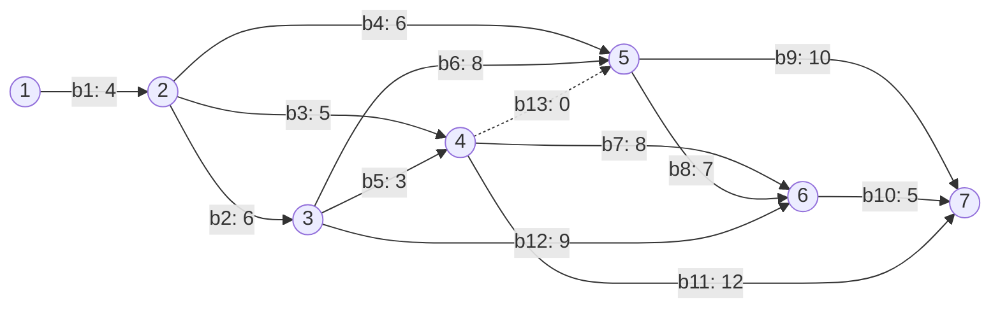

# Моделирование и анализ сетевого графика IT-проекта

Учебное Python-приложение для расчёта параметров структурно-сетевой модели проекта. Предметная модель описывает разработку интеллектуального чат-бота для сопровождения учащихся онлайн-школы; само приложение анализирует **план проекта**, а не реализует чат-бот.

## Возможности

- ввод длительностей 13 работ и построение сетевого графика из 7 событий;
- расчёт ранних и поздних сроков событий и их резервов;
- расчёт резервов работ и определение критических работ/критического пути;
- визуальное выделение критического пути в графическом интерфейсе Tkinter;
- сохранение результатов расчётов в CSV и формирование текстовых отчётов;
- имитационное моделирование: три диапазона вариации длительностей по 1 000 прогонов, всего 3 000 сценариев;
- подсчёт критических и предкритических работ и визуализация результатов с Matplotlib;
- тест-план с контрольными входными данными и ожидаемыми результатами.

## Пример модели



Для базового сценария длительность проекта составляет 30 условных единиц, а критический путь: `b1 → b2 → b6 → b8 → b10`.

## Стек

Python, Tkinter, Matplotlib, CSV.

## Структура репозитория

```text
src/                 # сюда переносится исходный Python-код из М2/М3
examples/            # исходные справочники работ и событий
docs/                # модель, алгоритм, тест-план, происхождение материалов
requirements.txt
```

## Как подготовить исходный код к публикации

В присланных отчётах код находится внутри Word-документов. Его следует вынести в отдельные файлы без смысловой переработки:

```text
src/main.py          # интерфейс Tkinter, расчёт и моделирование
src/report.py        # запись расчётов в CSV
src/txt_report.py    # создание текстовых отчётов
```

После переноса проверьте, что запуск не создаёт результатные `.csv`, `.txt` и `.png` рядом с кодом: их нужно направить в `output/` и оставить в `.gitignore`. Исходные файлы программы в этом наборе не приложены отдельно, поэтому репозиторий содержит готовую документацию и примеры, но не притворяется исполняемой поставкой.

## Источники и академическая честность

Репозиторий описывает выполненное моделирование сетевого графика. Не заявляйте, что Telegram-бот, LLM, ETL-конвейер или инфраструктура нейрокуратора были реализованы: они являются работами **моделируемого** проекта.
