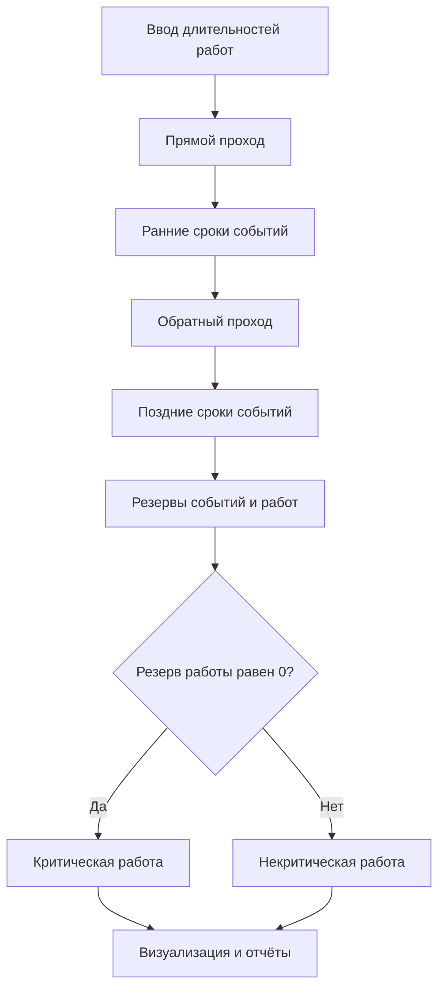

# Алгоритм расчёта

Для заданного набора длительностей приложение выполняет прямой и обратный проход по сетевому графику.

При моделировании для каждого из трёх диапазонов изменения длительностей выполняется 1 000 прогонов. Для каждой работы сохраняются длительность, резерв и зона: критическая, предкритическая или некритическая. Затем подсчитывается частота попадания в первые две зоны и строятся диаграммы Matplotlib.
