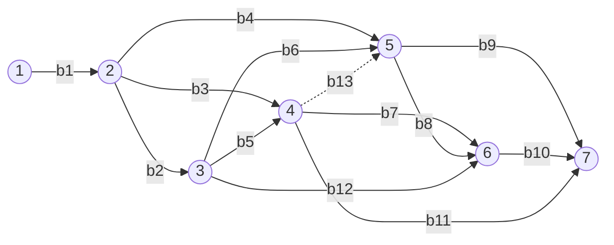

# Структурно-сетевая модель

Модель содержит 7 событий и 13 работ. Работа `b13` имеет нулевую длительность и используется для задания логической зависимости между событиями 4 и 5.

Базовые длительности и результаты работ находятся в [examples/works.csv](../examples/works.csv); названия событий — в [examples/events.csv](../examples/events.csv).
